# Plan de Implementación CineMatch

## 1. Resumen del alcance
- Frontend cinematográfico interactivo tipo SPA desarrollado en React 19 + TypeScript + Vite.
- Operación 100% con Mock Data y persistencia reactiva en `localStorage`.
- Funcionalidades: exploración, tendencias, catálogo integrado con filtros y búsqueda global, recomendaciones por similitud, detalle con tabs y trailers simulados, rating interactivo (1 a 5 estrellas), gestión de lista de seguimiento y perfil con historial y preferencias.
- Destinado a actuar como frontend funcional y fuente de mockups de alta fidelidad.

---

## 2. Correcciones respecto al plan original
- **Unificación de Búsqueda y Catálogo**: Se elimina `SearchView` independiente; la búsqueda, filtros y catálogo coexisten en `CatalogView`.
- **Navegación lateral estricta**: Se fija en exactamente 5 ítems: Inicio, Catálogo, Recomendaciones, Mi lista, Mi perfil.
- **Escala de calificación**: Se corrige de 10 estrellas a 1 a 5 estrellas (`★☆☆☆☆` a `★★★★★`).
- **Ancho del Sidebar**: Reducido de 260px a 200px-220px para preservar densidad y proporciones cinematográficas.
- **Eliminación de Masonry**: Se reemplaza por filas horizontales estructuradas para tendencias y recomendaciones.
- **Microinteracciones**: Reducción del hover scale en `MovieCard` de `1.05x` a `translateY(-4px) scale(1.01)`.
- **Ruteo simplificado**: Navegación interna unificada por estado en Context (`activeView`, `selectedMovieId`) sin React Router.

---

## 3. Arquitectura final
```text
App
├── CineMatchContext (Estado global + LocalStorage)
└── AppLayout
    ├── Sidebar (Fijo, 200px-220px, 5 enlaces)
    └── MainContent (Scrollable)
        ├── Topbar (Buscador global, notificaciones, avatar)
        └── CurrentView
            ├── HomeView
            ├── CatalogView (Búsqueda + Filtros + Grid)
            ├── RecommendationsView
            ├── MovieDetailView
            ├── MyListView
            └── ProfileView
```

---

## 4. Stack confirmado
- **Core**: React 19, TypeScript, Vite.
- **Estilos**: Vanilla CSS con Custom Properties (`:root`).
- **Iconos**: Lucide React (`lucide-react`).
- **Estado**: React Context + `useReducer` / `useState`.
- **Persistencia**: Web Storage API (`localStorage`).
- **Exclusiones estrictas**: Sin Tailwind, sin UI frameworks (MUI, Chakra, shadcn), sin Redux/Zustand, sin backend/APIs externas.

---

## 5. Sistema de diseño

### 5.1 Tokens de color
```css
:root {
  --bg-primary: #0F0F1A;
  --bg-secondary: #161626;
  --bg-surface: #1E1E34;
  --brand-primary: #7C3AED;
  --brand-secondary: #A78BFA;
  --text-main: #E5E7EB;
  --text-muted: #9CA3AF;
  --accent-pink: #F472B6;
  --border-color: rgba(255, 255, 255, 0.08);
  --overlay-dark: rgba(15, 15, 26, 0.72);
  --btn-gradient: linear-gradient(90deg, #7C3AED 0%, #F472B6 100%);
}
```

### 5.2 Tipografía
- **Headings (H1, H2, títulos destacados)**: `Montserrat, sans-serif` (Pesos 600, 700). Títulos en `#E5E7EB` con acentos puntuales en `#7C3AED`.
- **Cuerpo y UI (body, botones, inputs, metadatos)**: `Inter, sans-serif` (Pesos 400, 500, 600).
- **Escala**:
  - H1: `32px` / Bold (700)
  - H2: `24px` / SemiBold (600)
  - H3: `18px` / SemiBold (600)
  - Body: `14px` / Regular (400) / Line-height: 1.5
  - Small: `12px` / Medium (500)

### 5.3 Espaciado y radios
- **Escala de espaciado**: `4px`, `8px`, `12px`, `16px`, `20px`, `24px`, `32px`, `40px`, `48px`.
- **Radios**:
  - Contenedores principales: `12px`
  - Cards: `8px` - `10px`
  - Botones e Inputs: `8px`
  - Chips / Badges: `999px`

---

## 6. Modelo de datos (`src/types/index.ts`)

```ts
export type MovieType = "movie" | "series";

export interface Movie {
  id: string;
  title: string;
  year: number;
  genres: string[];
  duration: string;
  synopsis: string;
  director: string;
  cast: string[];
  posterUrl: string;
  backdropUrl: string;
  rating: number;
  ratingCount: number;
  releaseDate: string;
  type: MovieType;
  trending?: boolean;
}

export interface UserPreferences {
  notifications: boolean;
  autoplayTrailers: boolean;
  adultContent: boolean;
}

export interface User {
  id: string;
  name: string;
  email: string;
  avatarUrl: string;
  myListMovieIds: string[];
  preferences: UserPreferences;
}

export interface Rating {
  id: string;
  userId: string;
  movieId: string;
  score: number;
  createdAt: string;
  review?: string;
}

export type ActiveView =
  | "home"
  | "catalog"
  | "recommendations"
  | "movie-detail"
  | "my-list"
  | "profile";

export interface CatalogFilters {
  query: string;
  type: "all" | "movie" | "series";
  genres: string[];
  yearMin: number;
  yearMax: number;
  minRating: number;
}
```

---

## 7. Estado y persistencia

### 7.1 Estado en Context (`CineMatchContext`)
- `activeView`: Vista actual en renderizado.
- `selectedMovieId`: ID de película activa para vista de detalle.
- `movies`: Colección de 18-24 películas/series.
- `user`: Usuario activo (`u001`).
- `myList`: Array de IDs de películas guardadas.
- `ratings`: Array de objetos `Rating` (1 a 5 estrellas + review).
- `filters`: Objeto reactivo `CatalogFilters`.

### 7.2 Acciones expuestas
- `navigate(view: ActiveView)`
- `selectMovie(movieId: string)`
- `toggleMyList(movieId: string)`
- `rateMovie(movieId: string, score: number, review?: string)`
- `updatePreferences(prefs: Partial<UserPreferences>)`
- `setCatalogFilters(filters: Partial<CatalogFilters>)`
- `clearFilters()`

### 7.3 Claves de LocalStorage
- `cinematch_my_list`: Array de IDs `['m101', 'm102']`.
- `cinematch_ratings`: Array de objetos `Rating`.
- `cinematch_preferences`: Objeto `UserPreferences`.

---

## 8. Estructura de archivos

```text
src/
├── assets/
│   ├── branding/
│   │   └── CineMatch.png
│   ├── movies/
│   └── avatars/
├── components/
│   ├── layout/
│   │   ├── AppLayout.tsx
│   │   ├── AppLayout.css
│   │   ├── Sidebar.tsx
│   │   ├── Sidebar.css
│   │   ├── Topbar.tsx
│   │   └── Topbar.css
│   └── ui/
│       ├── Button.tsx
│       ├── Button.css
│       ├── MovieCard.tsx
│       ├── MovieCard.css
│       ├── StarRating.tsx
│       ├── StarRating.css
│       ├── SearchInput.tsx
│       ├── RatingBadge.tsx
│       ├── GenreFilter.tsx
│       ├── Tabs.tsx
│       ├── EmptyState.tsx
│       └── SectionHeader.tsx
├── context/
│   └── CineMatchContext.tsx
├── data/
│   ├── movies.ts
│   ├── users.ts
│   └── ratings.ts
├── hooks/
│   ├── useCineMatch.ts
│   └── useLocalStorage.ts
├── types/
│   └── index.ts
├── views/
│   ├── HomeView.tsx
│   ├── HomeView.css
│   ├── CatalogView.tsx
│   ├── CatalogView.css
│   ├── RecommendationsView.tsx
│   ├── RecommendationsView.css
│   ├── MovieDetailView.tsx
│   ├── MovieDetailView.css
│   ├── MyListView.tsx
│   ├── MyListView.css
│   ├── ProfileView.tsx
│   └── ProfileView.css
├── App.tsx
├── main.tsx
└── index.css
```

---

## 9. Componentes

- **`AppLayout`**: Contenedor principal con grid de 2 columnas (`Sidebar` fija y `MainContent` desplazable).
- **`Sidebar`**: Navegación principal con 5 ítems exactos, logo superior, estado activo e hover discreto.
- **`Topbar`**: Input de búsqueda con debounce (250ms), icono de campana y avatar de usuario con enlace a perfil.
- **`MovieCard`**: Aspect ratio `2/3`, badge de rating rosa, título, año, botón rápido de lista, hover `translateY(-4px) scale(1.01)` y evento click para navegación a detalle.
- **`StarRating`**: Control interactivo de 1 a 5 estrellas con modo lectura y escritura, hover de preselección.
- **`SearchInput`**: Input estilizado con icono `Search` y hint `Ctrl+K`.
- **`RatingBadge`**: Badge compacto para cards y headers con estrella y puntuación decimal.
- **`Tabs`**: Navegación de pestañas con borde inferior activo.
- **`EmptyState`**: Mensaje ilustrativo con icono y botón de acción para listas o búsquedas sin resultados.
- **`Button`**: Variantes `primary` (gradiente o púrpura), `secondary` (superficie oscura), `outline` (borde sutil) y `ghost`.

---

## 10. Navegación
- **Ruta Inicio (`home`)**: Icono `House`.
- **Ruta Catálogo (`catalog`)**: Icono `Film`.
- **Ruta Recomendaciones (`recommendations`)**: Icono `Sparkles`.
- **Ruta Mi lista (`my-list`)**: Icono `Bookmark`.
- **Ruta Mi perfil (`profile`)**: Icono `UserRound`.
- **Ruta Detalle (`movie-detail`)**: Acceso programático al hacer clic en cualquier `MovieCard`.

---

## 11. Inicio (`HomeView`)
- **Hero Section**:
  - Backdrop cinematográfico con gradiente radial y overlay oscuro `--overlay-dark`.
  - Titular: *"Descubre películas que <span style="color: var(--brand-primary)">van contigo</span>"*.
  - Subtítulo: *"Recomendaciones personalizadas basadas en tus gustos."*.
  - CTAs: "Ver recomendaciones" (`primary`) y "Explorar catálogo" (`outline`).
- **Sección Tendencias esta semana**:
  - Encabezado de sección con enlace "Ver todas >" (redirige a Catálogo).
  - Fila horizontal de 6 películas destacadas (`trending: true`).

---

## 12. Recomendaciones (`RecommendationsView`)
- **Encabezado**: *"✦ Recomendaciones para ti"* con subtítulo *"Basadas en tus calificaciones y gustos"*.
- **Bloque 1 ("Recomendaciones para ti")**: Fila horizontal de películas seleccionadas con base en puntuación general y géneros favoritos del usuario.
- **Bloque 2 ("Porque te gustó [Título]")**: Fila horizontal generada dinámicamente a partir de una película calificada con 4 o 5 estrellas.

---

## 13. Catálogo (`CatalogView`)
- **Estructura en 2 columnas**:
  - Panel izquierdo (180px - 220px): Filtros.
  - Panel derecho: Barra de tabs superiores y grid de resultados.
- **Tabs superiores**: "Todos", "Películas", "Series".
- **Filtros laterales**:
  - Checkboxes de género: Aventura, Ciencia ficción, Comedia, Drama, Terror, Acción.
  - Rango de años: Selectores / inputs min-max (ej. 2000 - 2024).
  - Calificación mínima: Selector de estrellas (1+, 2+, 3+, 4+, 5).
  - Botón: "Limpiar filtros".
- **Resultados**: Contador ("X resultados para '[término]'"), grid de `MovieCard` y `EmptyState` en caso de 0 coincidencias.

---

## 14. Detalle (`MovieDetailView`)
- **Hero Banner**:
  - Backdrop panorámico con degradado a `--bg-primary`.
  - Poster 2:3 insertado en la composición.
  - Metadatos: Título, año, duración, géneros, promedio y total de calificaciones (`★ 4.8 (135 mil calificaciones)`).
  - Acciones: Botón "Ver trailer" (abre modal de simulación) y botón "+ Mi lista" / "✓ En mi lista".
- **Tabs de contenido**:
  - **Información**: Sinopsis completa, director, reparto principal, detalles de estreno.
  - **Reparto**: Grid de chips o cards con nombres de actores y personajes.
  - **Reseñas**: Listado de opiniones existentes y formulario de nueva reseña.
- **Panel lateral de calificación**:
  - Título: "Califica esta película".
  - Componente `StarRating` interactivo (1 a 5 estrellas).
  - Área de texto para reseña opcional.
  - Botón "Guardar calificación" que actualiza estado y `localStorage`.

---

## 15. Mi lista (`MyListView`)
- **Encabezado**: *"Mi lista"* con subtítulo *"Películas que deseas ver o que te gustan"*.
- **Acción superior**: Botón "+ Agregar películas" que redirige al catálogo.
- **Grid de películas**: Tarjetas de títulos cuyo ID coincida con `myListMovieIds`. Cada tarjeta incluye opción de eliminar de la lista o ver detalle.
- **Estado vacío**: Componente `EmptyState` cuando `myList.length === 0` con CTA "Explorar catálogo".

---

## 16. Perfil (`ProfileView`)
- **Cabecera**: Avatar de usuario, nombre ("Usuario CineMatch"), correo y botón "Editar perfil".
- **Tabs de navegación interna**:
  1. **Historial de calificaciones**: Lista tabular/estructurada con thumbnail, título, año y estrellas otorgadas.
  2. **Mi lista**: Resumen compacto de películas guardadas.
  3. **Preferencias**: Switches interactivos para:
     - Notificaciones por correo.
     - Reproducción automática de trailers.
     - Filtro de contenido adulto.

---

## 17. Responsive
- **Desktop (≥ 1200px)**: Sidebar fija (200px-220px), catálogo en 2 columnas, grids de 4-6 columnas.
- **Tablet (768px - 1199px)**: Sidebar comprimida con iconos o panel colapsable, catálogo con filtros en acordeón superior, grids de 3-4 columnas.
- **Mobile (< 768px)**: Sidebar oculta con botón menú hamburguesa en Topbar, navegación mediante drawer lateral, grids de 1-2 columnas.

---

## 18. Accesibilidad
- Elementos interactivos implementados exclusivamente con `<button>`, `<a>`, `<input>` y `<select>`.
- Atributos `aria-label` en botones con solo icono (cerrar, búsqueda, notificaciones, eliminar de lista).
- Contraste visual mínimo 4.5:1 para textos principales sobre fondos oscuros.
- Atributos `alt` descriptivos en posters y backdrops.
- Indicadores visuales de foco (`:focus-visible`) con anillo `--brand-primary`.

---

## 19. Fases de implementación

```mermaid
graph LR
    F1[Fase 1: Auditoría] --> F2[Fase 2: Design Tokens]
    F2 --> F3[Fase 3: Mock Data & Tipos]
    F3 --> F4[Fase 4: Context & Storage]
    F4 --> F5[Fase 5: Shell & Layout]
    F5 --> F6[Fase 6: UI Components]
    F6 --> F7[Fase 7: HomeView]
    F7 --> F8[Fase 8: CatalogView]
    F8 --> F9[Fase 9: Recommendations]
    F9 --> F10[Fase 10: MovieDetail]
    F10 --> F11[Fase 11: MyList & Profile]
    F11 --> F12[Fase 12: Responsive & QA]
```



1. **Fase 1 — Auditoría y Preparación**: Revisión de dependencias, verificación de fuentes Google (Montserrat e Inter) en `index.html` e integración de Lucide Icons.
2. **Fase 2 — Sistema de Diseño**: Definición de variables CSS en `src/index.css`, reset tipográfico y utilidades de layout.
3. **Fase 3 — Tipos y Mock Data**: Creación de `src/types/index.ts` y datasets estructurados en `src/data/` (`movies.ts`, `users.ts`, `ratings.ts`).
4. **Fase 4 — Estado Global**: Implementación de `CineMatchContext.tsx` con persistencia en `localStorage`.
5. **Fase 5 — Layout & Shell**: Creación de `AppLayout`, `Sidebar` fija y `Topbar` integrada.
6. **Fase 6 — Componentes Compartidos**: Construcción de `MovieCard`, `StarRating`, `Button`, `SearchInput`, `Tabs` y `EmptyState`.
7. **Fase 7 — Vista Inicio**: Implementación de Hero section con gradientes y fila de Tendencias.
8. **Fase 8 — Vista Catálogo**: Implementación de filtros combinados (género, año, estrellas) y búsqueda reactiva.
9. **Fase 9 — Vista Recomendaciones**: Generación de filas por similitud y recomendaciones personalizadas.
10. **Fase 10 — Vista Detalle**: Backdrop hero, tabs de información/elenco/reseñas y panel de calificación.
11. **Fase 11 — Vistas Mi Lista y Perfil**: Grid de guardados, historial de calificaciones y switches de preferencias.
12. **Fase 12 — Responsive, Accesibilidad y QA**: Adaptabilidad móvil/tablet, validación con `npm run build`.

---

## 20. Validaciones
- Compilación estricta de TypeScript: `tsc -b` sin advertencias ni errores.
- Empaquetado exitoso de producción: `vite build` en salida limpia.
- Verificación funcional de persistencia: actualización de `localStorage` comprobable tras recargar navegador.
- Comprobación de filtros en Catálogo: combinaciones multi-criterio bajo condición AND.

---

## 21. Criterios de aceptación
- [ ] Sidebar fija con exactamente los 5 accesos definidos y estados activos consistentes.
- [ ] Buscador global en Topbar funcional con debounce que actualiza el Catálogo.
- [ ] Componente `StarRating` restringido estrictamente a escala 1 a 5 estrellas.
- [ ] Películas agregadas/eliminadas en "Mi lista" reflejadas de inmediato en contador, cards y vistas.
- [ ] Calificación de película guardada reflejada en el historial del Perfil.
- [ ] Vista Detalle con cambio interactivo de tabs (Información, Reparto, Reseñas).
- [ ] Preferencias de usuario modificables y persistentes en `localStorage`.
- [ ] Ausencia de errores de consola y build en verde.

---

## 22. Fuera de alcance
- Autenticación real (login, registro, recuperación, JWT o Firebase Auth).
- Backend, base de datos relacional/NoSQL o endpoints REST/GraphQL.
- Integración con APIs externas (TMDB, IMDb, etc.).
- Reproducción real de archivos de video o streaming.
- Pasarela de pagos o suscripciones.
- Panel o dashboard de administración / CRUD de películas.
